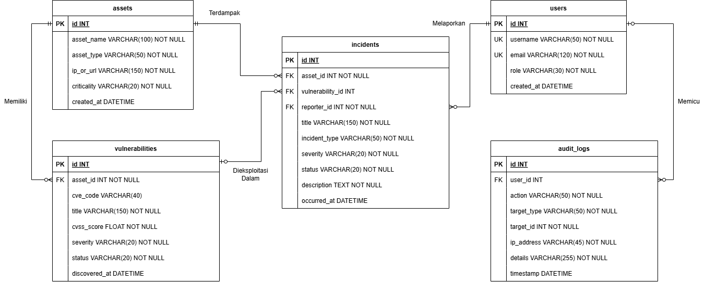

# SecTrack API — Cybersecurity Asset, Vulnerability, Incident & Audit Management REST API

MVP REST API berbasis **Python Flask**, **SQLAlchemy ORM**, dan arsitektur **MVC** untuk memenuhi Ujian Tengah Semester (UTS) mata kuliah **Pemrograman Web Lanjut (TK070)** — Program Studi S1-Teknik Komputer, Universitas Amikom Yogyakarta.

- **Nama:** Valerian Kaleb Setiawirawan
- **NIM:** 23.83.0965
- **Kelas:** 23 TK01
- **Live Demo URL:** *(akan diperbarui setelah deployment)*
- **Spesifikasi OpenAPI 3.0:** [`openapi.yaml`](./openapi.yaml)

---

## Ringkasan Sistem & ERD

SecTrack API menghubungkan 5 tabel relasional utama (`users`, `assets`, `vulnerabilities`, `incidents`, `audit_logs`) untuk memantau inventaris aset digital, pelacakan kerentanan (CVSS), pelaporan insiden keamanan, dan pencatatan *audit log* otomatis pada lingkungan simulasi lokal.



---

## 1. Instalasi Dependency

Pastikan Python 3.10+ telah terpasang, lalu jalankan perintah berikut:

```bash
git clone [https://github.com/](https://github.com/)valeriankaleb/sectrack-api.git
cd sectrack-api
python -m venv venv

# Aktivasi virtual environment (Windows CMD/PowerShell):
venv\Scripts\activate
# Aktivasi virtual environment (Linux/macOS):
source venv/bin/activate

pip install -r requirements.txt